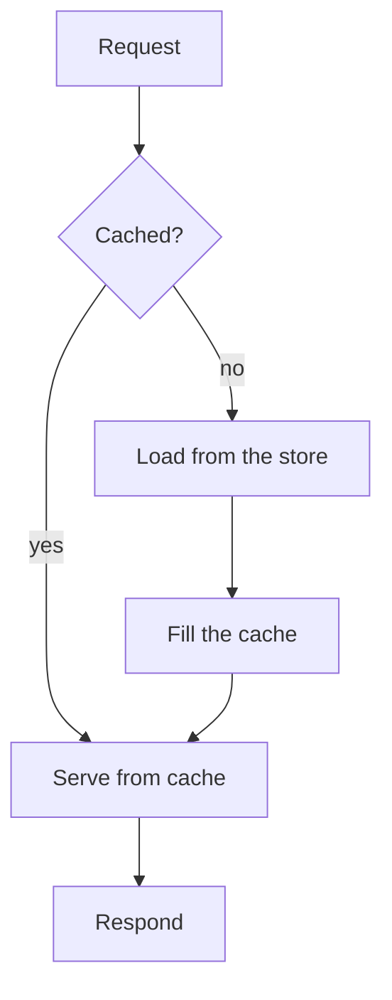
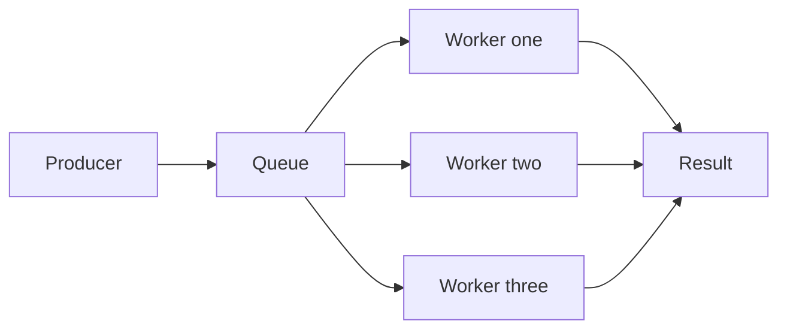

# Back restore

A long note for the walk out and back: the paragraphs, code blocks and diagrams between its sections are drawn after the browser has laid the page out once, and the walk returns to every place it leaves from. The note it walks to is [[Reading flow detour]].

## The First section

Sentence 0 of first, paragraph 0 puts one more line of the explanation between the blocks around it. Sentence 1 of first, paragraph 0 puts one more line of the explanation between the blocks around it. Sentence 2 of first, paragraph 0 puts one more line of the explanation between the blocks around it. Sentence 3 of first, paragraph 0 puts one more line of the explanation between the blocks around it. Sentence 4 of first, paragraph 0 puts one more line of the explanation between the blocks around it.

Sentence 0 of first, paragraph 1 puts one more line of the explanation between the blocks around it. Sentence 1 of first, paragraph 1 puts one more line of the explanation between the blocks around it. Sentence 2 of first, paragraph 1 puts one more line of the explanation between the blocks around it. Sentence 3 of first, paragraph 1 puts one more line of the explanation between the blocks around it. Sentence 4 of first, paragraph 1 puts one more line of the explanation between the blocks around it.

Sentence 0 of first, paragraph 2 puts one more line of the explanation between the blocks around it. Sentence 1 of first, paragraph 2 puts one more line of the explanation between the blocks around it. Sentence 2 of first, paragraph 2 puts one more line of the explanation between the blocks around it. Sentence 3 of first, paragraph 2 puts one more line of the explanation between the blocks around it. Sentence 4 of first, paragraph 2 puts one more line of the explanation between the blocks around it.

```go
package main

import "fmt"

func main() {
	fmt.Println("first")
}
```

Sentence 0 of first after, paragraph 0 puts one more line of the explanation between the blocks around it. Sentence 1 of first after, paragraph 0 puts one more line of the explanation between the blocks around it. Sentence 2 of first after, paragraph 0 puts one more line of the explanation between the blocks around it. Sentence 3 of first after, paragraph 0 puts one more line of the explanation between the blocks around it. Sentence 4 of first after, paragraph 0 puts one more line of the explanation between the blocks around it.

Sentence 0 of first after, paragraph 1 puts one more line of the explanation between the blocks around it. Sentence 1 of first after, paragraph 1 puts one more line of the explanation between the blocks around it. Sentence 2 of first after, paragraph 1 puts one more line of the explanation between the blocks around it. Sentence 3 of first after, paragraph 1 puts one more line of the explanation between the blocks around it. Sentence 4 of first after, paragraph 1 puts one more line of the explanation between the blocks around it.

Sentence 0 of first after, paragraph 2 puts one more line of the explanation between the blocks around it. Sentence 1 of first after, paragraph 2 puts one more line of the explanation between the blocks around it. Sentence 2 of first after, paragraph 2 puts one more line of the explanation between the blocks around it. Sentence 3 of first after, paragraph 2 puts one more line of the explanation between the blocks around it. Sentence 4 of first after, paragraph 2 puts one more line of the explanation between the blocks around it.

## The Second section

Sentence 0 of second, paragraph 0 puts one more line of the explanation between the blocks around it. Sentence 1 of second, paragraph 0 puts one more line of the explanation between the blocks around it. Sentence 2 of second, paragraph 0 puts one more line of the explanation between the blocks around it. Sentence 3 of second, paragraph 0 puts one more line of the explanation between the blocks around it. Sentence 4 of second, paragraph 0 puts one more line of the explanation between the blocks around it.

Sentence 0 of second, paragraph 1 puts one more line of the explanation between the blocks around it. Sentence 1 of second, paragraph 1 puts one more line of the explanation between the blocks around it. Sentence 2 of second, paragraph 1 puts one more line of the explanation between the blocks around it. Sentence 3 of second, paragraph 1 puts one more line of the explanation between the blocks around it. Sentence 4 of second, paragraph 1 puts one more line of the explanation between the blocks around it.

Sentence 0 of second, paragraph 2 puts one more line of the explanation between the blocks around it. Sentence 1 of second, paragraph 2 puts one more line of the explanation between the blocks around it. Sentence 2 of second, paragraph 2 puts one more line of the explanation between the blocks around it. Sentence 3 of second, paragraph 2 puts one more line of the explanation between the blocks around it. Sentence 4 of second, paragraph 2 puts one more line of the explanation between the blocks around it.



Sentence 0 of second after, paragraph 0 puts one more line of the explanation between the blocks around it. Sentence 1 of second after, paragraph 0 puts one more line of the explanation between the blocks around it. Sentence 2 of second after, paragraph 0 puts one more line of the explanation between the blocks around it. Sentence 3 of second after, paragraph 0 puts one more line of the explanation between the blocks around it. Sentence 4 of second after, paragraph 0 puts one more line of the explanation between the blocks around it.

Sentence 0 of second after, paragraph 1 puts one more line of the explanation between the blocks around it. Sentence 1 of second after, paragraph 1 puts one more line of the explanation between the blocks around it. Sentence 2 of second after, paragraph 1 puts one more line of the explanation between the blocks around it. Sentence 3 of second after, paragraph 1 puts one more line of the explanation between the blocks around it. Sentence 4 of second after, paragraph 1 puts one more line of the explanation between the blocks around it.

Sentence 0 of second after, paragraph 2 puts one more line of the explanation between the blocks around it. Sentence 1 of second after, paragraph 2 puts one more line of the explanation between the blocks around it. Sentence 2 of second after, paragraph 2 puts one more line of the explanation between the blocks around it. Sentence 3 of second after, paragraph 2 puts one more line of the explanation between the blocks around it. Sentence 4 of second after, paragraph 2 puts one more line of the explanation between the blocks around it.

## The Third section

Sentence 0 of third, paragraph 0 puts one more line of the explanation between the blocks around it. Sentence 1 of third, paragraph 0 puts one more line of the explanation between the blocks around it. Sentence 2 of third, paragraph 0 puts one more line of the explanation between the blocks around it. Sentence 3 of third, paragraph 0 puts one more line of the explanation between the blocks around it. Sentence 4 of third, paragraph 0 puts one more line of the explanation between the blocks around it.

Sentence 0 of third, paragraph 1 puts one more line of the explanation between the blocks around it. Sentence 1 of third, paragraph 1 puts one more line of the explanation between the blocks around it. Sentence 2 of third, paragraph 1 puts one more line of the explanation between the blocks around it. Sentence 3 of third, paragraph 1 puts one more line of the explanation between the blocks around it. Sentence 4 of third, paragraph 1 puts one more line of the explanation between the blocks around it.

Sentence 0 of third, paragraph 2 puts one more line of the explanation between the blocks around it. Sentence 1 of third, paragraph 2 puts one more line of the explanation between the blocks around it. Sentence 2 of third, paragraph 2 puts one more line of the explanation between the blocks around it. Sentence 3 of third, paragraph 2 puts one more line of the explanation between the blocks around it. Sentence 4 of third, paragraph 2 puts one more line of the explanation between the blocks around it.

```text
plain	<-

last line
```

Sentence 0 of third after, paragraph 0 puts one more line of the explanation between the blocks around it. Sentence 1 of third after, paragraph 0 puts one more line of the explanation between the blocks around it. Sentence 2 of third after, paragraph 0 puts one more line of the explanation between the blocks around it. Sentence 3 of third after, paragraph 0 puts one more line of the explanation between the blocks around it. Sentence 4 of third after, paragraph 0 puts one more line of the explanation between the blocks around it.

Sentence 0 of third after, paragraph 1 puts one more line of the explanation between the blocks around it. Sentence 1 of third after, paragraph 1 puts one more line of the explanation between the blocks around it. Sentence 2 of third after, paragraph 1 puts one more line of the explanation between the blocks around it. Sentence 3 of third after, paragraph 1 puts one more line of the explanation between the blocks around it. Sentence 4 of third after, paragraph 1 puts one more line of the explanation between the blocks around it.

Sentence 0 of third after, paragraph 2 puts one more line of the explanation between the blocks around it. Sentence 1 of third after, paragraph 2 puts one more line of the explanation between the blocks around it. Sentence 2 of third after, paragraph 2 puts one more line of the explanation between the blocks around it. Sentence 3 of third after, paragraph 2 puts one more line of the explanation between the blocks around it. Sentence 4 of third after, paragraph 2 puts one more line of the explanation between the blocks around it.

## The Fourth section

Sentence 0 of fourth, paragraph 0 puts one more line of the explanation between the blocks around it. Sentence 1 of fourth, paragraph 0 puts one more line of the explanation between the blocks around it. Sentence 2 of fourth, paragraph 0 puts one more line of the explanation between the blocks around it. Sentence 3 of fourth, paragraph 0 puts one more line of the explanation between the blocks around it. Sentence 4 of fourth, paragraph 0 puts one more line of the explanation between the blocks around it.

Sentence 0 of fourth, paragraph 1 puts one more line of the explanation between the blocks around it. Sentence 1 of fourth, paragraph 1 puts one more line of the explanation between the blocks around it. Sentence 2 of fourth, paragraph 1 puts one more line of the explanation between the blocks around it. Sentence 3 of fourth, paragraph 1 puts one more line of the explanation between the blocks around it. Sentence 4 of fourth, paragraph 1 puts one more line of the explanation between the blocks around it.

Sentence 0 of fourth, paragraph 2 puts one more line of the explanation between the blocks around it. Sentence 1 of fourth, paragraph 2 puts one more line of the explanation between the blocks around it. Sentence 2 of fourth, paragraph 2 puts one more line of the explanation between the blocks around it. Sentence 3 of fourth, paragraph 2 puts one more line of the explanation between the blocks around it. Sentence 4 of fourth, paragraph 2 puts one more line of the explanation between the blocks around it.

    an indented block,
    written without a fence

Sentence 0 of fourth after, paragraph 0 puts one more line of the explanation between the blocks around it. Sentence 1 of fourth after, paragraph 0 puts one more line of the explanation between the blocks around it. Sentence 2 of fourth after, paragraph 0 puts one more line of the explanation between the blocks around it. Sentence 3 of fourth after, paragraph 0 puts one more line of the explanation between the blocks around it. Sentence 4 of fourth after, paragraph 0 puts one more line of the explanation between the blocks around it.

Sentence 0 of fourth after, paragraph 1 puts one more line of the explanation between the blocks around it. Sentence 1 of fourth after, paragraph 1 puts one more line of the explanation between the blocks around it. Sentence 2 of fourth after, paragraph 1 puts one more line of the explanation between the blocks around it. Sentence 3 of fourth after, paragraph 1 puts one more line of the explanation between the blocks around it. Sentence 4 of fourth after, paragraph 1 puts one more line of the explanation between the blocks around it.

Sentence 0 of fourth after, paragraph 2 puts one more line of the explanation between the blocks around it. Sentence 1 of fourth after, paragraph 2 puts one more line of the explanation between the blocks around it. Sentence 2 of fourth after, paragraph 2 puts one more line of the explanation between the blocks around it. Sentence 3 of fourth after, paragraph 2 puts one more line of the explanation between the blocks around it. Sentence 4 of fourth after, paragraph 2 puts one more line of the explanation between the blocks around it.

## The Fifth section

Sentence 0 of fifth, paragraph 0 puts one more line of the explanation between the blocks around it. Sentence 1 of fifth, paragraph 0 puts one more line of the explanation between the blocks around it. Sentence 2 of fifth, paragraph 0 puts one more line of the explanation between the blocks around it. Sentence 3 of fifth, paragraph 0 puts one more line of the explanation between the blocks around it. Sentence 4 of fifth, paragraph 0 puts one more line of the explanation between the blocks around it.

Sentence 0 of fifth, paragraph 1 puts one more line of the explanation between the blocks around it. Sentence 1 of fifth, paragraph 1 puts one more line of the explanation between the blocks around it. Sentence 2 of fifth, paragraph 1 puts one more line of the explanation between the blocks around it. Sentence 3 of fifth, paragraph 1 puts one more line of the explanation between the blocks around it. Sentence 4 of fifth, paragraph 1 puts one more line of the explanation between the blocks around it.

Sentence 0 of fifth, paragraph 2 puts one more line of the explanation between the blocks around it. Sentence 1 of fifth, paragraph 2 puts one more line of the explanation between the blocks around it. Sentence 2 of fifth, paragraph 2 puts one more line of the explanation between the blocks around it. Sentence 3 of fifth, paragraph 2 puts one more line of the explanation between the blocks around it. Sentence 4 of fifth, paragraph 2 puts one more line of the explanation between the blocks around it.



Sentence 0 of fifth after, paragraph 0 puts one more line of the explanation between the blocks around it. Sentence 1 of fifth after, paragraph 0 puts one more line of the explanation between the blocks around it. Sentence 2 of fifth after, paragraph 0 puts one more line of the explanation between the blocks around it. Sentence 3 of fifth after, paragraph 0 puts one more line of the explanation between the blocks around it. Sentence 4 of fifth after, paragraph 0 puts one more line of the explanation between the blocks around it.

Sentence 0 of fifth after, paragraph 1 puts one more line of the explanation between the blocks around it. Sentence 1 of fifth after, paragraph 1 puts one more line of the explanation between the blocks around it. Sentence 2 of fifth after, paragraph 1 puts one more line of the explanation between the blocks around it. Sentence 3 of fifth after, paragraph 1 puts one more line of the explanation between the blocks around it. Sentence 4 of fifth after, paragraph 1 puts one more line of the explanation between the blocks around it.

Sentence 0 of fifth after, paragraph 2 puts one more line of the explanation between the blocks around it. Sentence 1 of fifth after, paragraph 2 puts one more line of the explanation between the blocks around it. Sentence 2 of fifth after, paragraph 2 puts one more line of the explanation between the blocks around it. Sentence 3 of fifth after, paragraph 2 puts one more line of the explanation between the blocks around it. Sentence 4 of fifth after, paragraph 2 puts one more line of the explanation between the blocks around it.

## The Sixth section

Sentence 0 of sixth, paragraph 0 puts one more line of the explanation between the blocks around it. Sentence 1 of sixth, paragraph 0 puts one more line of the explanation between the blocks around it. Sentence 2 of sixth, paragraph 0 puts one more line of the explanation between the blocks around it. Sentence 3 of sixth, paragraph 0 puts one more line of the explanation between the blocks around it. Sentence 4 of sixth, paragraph 0 puts one more line of the explanation between the blocks around it.

Sentence 0 of sixth, paragraph 1 puts one more line of the explanation between the blocks around it. Sentence 1 of sixth, paragraph 1 puts one more line of the explanation between the blocks around it. Sentence 2 of sixth, paragraph 1 puts one more line of the explanation between the blocks around it. Sentence 3 of sixth, paragraph 1 puts one more line of the explanation between the blocks around it. Sentence 4 of sixth, paragraph 1 puts one more line of the explanation between the blocks around it.

Sentence 0 of sixth, paragraph 2 puts one more line of the explanation between the blocks around it. Sentence 1 of sixth, paragraph 2 puts one more line of the explanation between the blocks around it. Sentence 2 of sixth, paragraph 2 puts one more line of the explanation between the blocks around it. Sentence 3 of sixth, paragraph 2 puts one more line of the explanation between the blocks around it. Sentence 4 of sixth, paragraph 2 puts one more line of the explanation between the blocks around it.

```go
package main

func answer() int {
	return 42
}
```

Sentence 0 of sixth after, paragraph 0 puts one more line of the explanation between the blocks around it. Sentence 1 of sixth after, paragraph 0 puts one more line of the explanation between the blocks around it. Sentence 2 of sixth after, paragraph 0 puts one more line of the explanation between the blocks around it. Sentence 3 of sixth after, paragraph 0 puts one more line of the explanation between the blocks around it. Sentence 4 of sixth after, paragraph 0 puts one more line of the explanation between the blocks around it.

Sentence 0 of sixth after, paragraph 1 puts one more line of the explanation between the blocks around it. Sentence 1 of sixth after, paragraph 1 puts one more line of the explanation between the blocks around it. Sentence 2 of sixth after, paragraph 1 puts one more line of the explanation between the blocks around it. Sentence 3 of sixth after, paragraph 1 puts one more line of the explanation between the blocks around it. Sentence 4 of sixth after, paragraph 1 puts one more line of the explanation between the blocks around it.

Sentence 0 of sixth after, paragraph 2 puts one more line of the explanation between the blocks around it. Sentence 1 of sixth after, paragraph 2 puts one more line of the explanation between the blocks around it. Sentence 2 of sixth after, paragraph 2 puts one more line of the explanation between the blocks around it. Sentence 3 of sixth after, paragraph 2 puts one more line of the explanation between the blocks around it. Sentence 4 of sixth after, paragraph 2 puts one more line of the explanation between the blocks around it.
