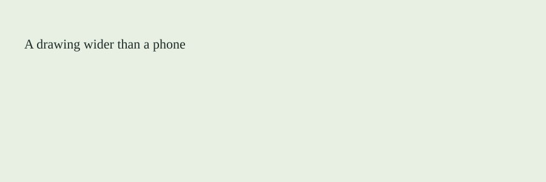
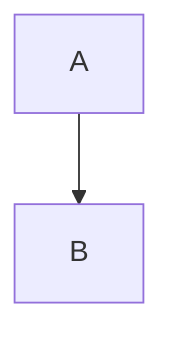

# Tables and plates

這篇筆記只為了量表格與圖版：放得下的表格留在正文的寬度裡，欄位擠的才走到寬欄；圖放在圖版上，作者寫了說明的才有圖說。

## 窄的表

| 詞 | 意思 |
|---|---|
| 快照 | 交易開始那一刻看到的資料 |
| 重試 | 失敗後從頭再做一次 |

## 對齊的數字

| 隔離等級 | 交易數 | 中止 | 比例 |
|:---|---:|---:|:---:|
| Read Committed | 12,480 | 3 | 0.02% |
| Repeatable Read | 12,480 | 41 | 0.33% |
| Serializable | 12,480 | 1,207 | 9.67% |

## 寬的表

| 隔離等級 | Dirty / Non-Repeatable | Phantom Read | Write Skew | 讀取阻塞寫入 | 客戶端重試要求 |
|---|---|---|---|---|---|
| **Read Committed** | 防髒讀，不防不可重複讀 | 可能發生 | 可能發生 | 否 | 僅處理 deadlock |
| **Repeatable Read（PG）** | 皆防（MVCC 快照） | PostgreSQL 實作已防 | 仍可能發生 | 否 | 需處理併發更新衝突 |
| **Serializable（PG SSI）** | 皆防 | 皆防（SIREAD 追蹤） | 皆防 | 否（樂觀中止） | 必備 `40001` 冪等重試迴圈 |
| **Strict Serializable（CRDB）** | 皆防 | 皆防 | 皆防（含跨節點真實時間序） | 依競爭度 | 必備 `40001` 與 HLC restart |

表格下面的正文，回到正文的寬度。

## 拉丁字母的表

| Term | Meaning |
|---|---|
| Snapshot | The data as it stood when the transaction began |
| Retry | Running the whole transaction again from its start |

| Level | What a reader sees | What the database guarantees | What the client must do | Where it breaks |
|---|---|---|---|---|
| Read committed | Every statement sees the rows committed before it began | No dirty reads and nothing more | Nothing beyond handling a deadlock | Two reads in one transaction disagree |
| Serializable | The transaction behaves as if it ran alone | Every anomaly is prevented by aborting one side | Retry the whole transaction on 40001 | Long transactions abort under contention |

## 圖版

一張小圖，沒有寫說明：

![[pic.svg|120]]

一張點陣圖，寫了說明：

## 圖解

由上往下的圖解留在正文的寬度裡，沒有圖說：

## 在提示框裡

> [!note] 提示框
> 提示框裡的表格留在提示框的寬度裡。
>
> | 隔離等級 | Dirty / Non-Repeatable | Phantom Read | Write Skew | 讀取阻塞寫入 | 客戶端重試要求 |
> |---|---|---|---|---|---|
> | Read Committed | 防髒讀，不防不可重複讀 | 可能發生 | 可能發生 | 否 | 僅處理 deadlock |

TABLES-END
