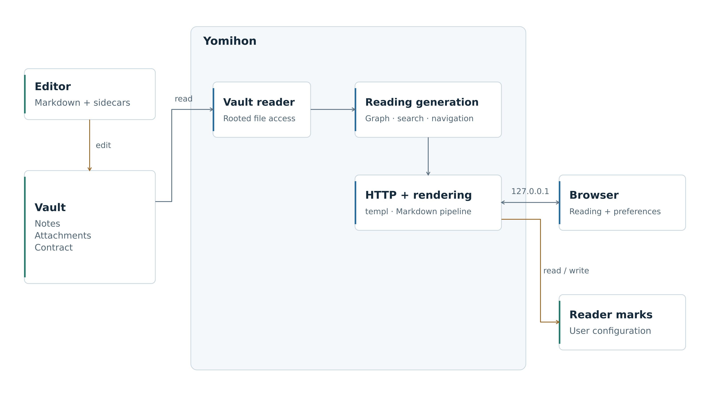
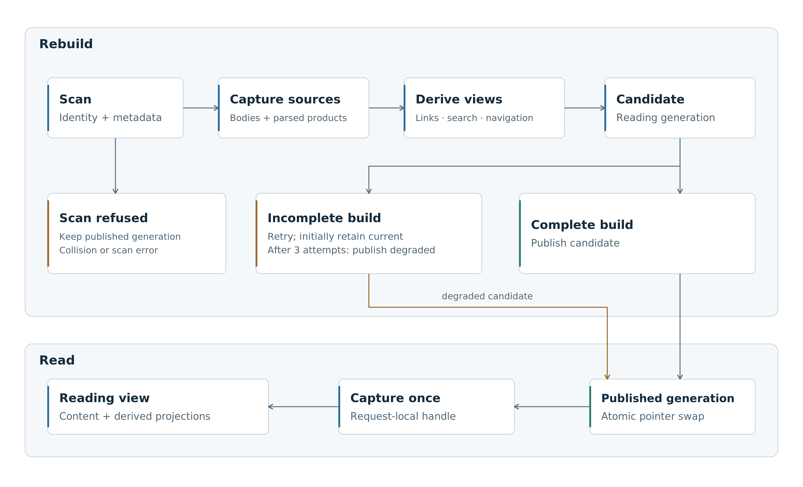
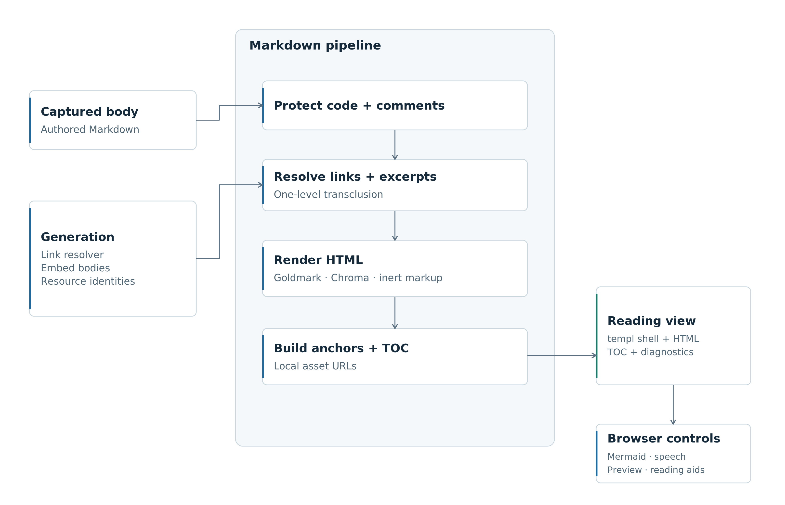
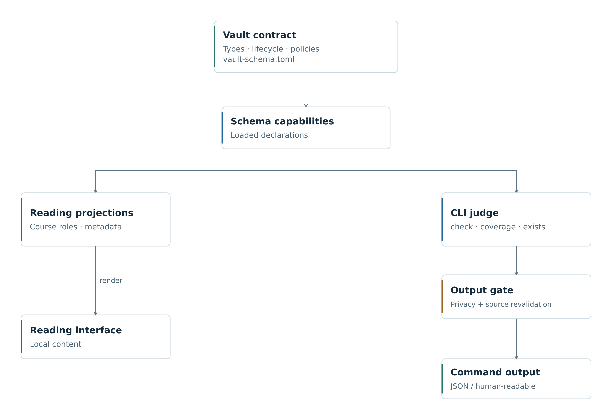

# Architecture

[繁體中文](ARCHITECTURE.zh-TW.md)

yomihon turns a folder of Markdown into a local reading environment. Authors keep writing in their editor; yomihon builds navigation, search, courses, and diagnostics from those files. It stores reading marks separately and never writes into the vault.

## 1. Reading model

The files remain authoritative. Derived views can be rebuilt, while the author's material and the reader's own state have different owners.

| Data | Owner and lifetime |
| --- | --- |
| Markdown, frontmatter, attachments, and lesson sidecars | The vault. Edited only outside yomihon; `draft: true` is the author's word that a note is unfinished. |
| `System/schemas/vault-schema.toml` | The vault's declarations: note types, fields, lifecycle, navigation roles, and output policies. |
| Reading generation | In-memory note bodies, link resolution, navigation, search, and diagnostics, replaced together. |
| Continuation and uncertainty marks | Application files in the local user's configuration directory, scoped to the vault. |
| Appearance and language preferences | Browser cookies; they change the interface, not the authored language or note contents. |

A wikilink cites a note, `based_on` declares a source, and a study path orders lessons. These relationships are projected separately: a citation does not put a lesson into a course, and a reading mark does not change a note's lifecycle. The [site][site] combines these [generation projections][snapshot].

`cmd/yomihon` composes feature packages around `vault.Reader`, `snapshot.Store`, and a per-request `schema.Authority`. HTTP handlers render `templ` views. Assets are embedded; native JavaScript modules add browser interactions and use the vendored Mermaid renderer. Serving needs no database or asset build pipeline. [Dependencies][modules] and [assets][assets] define what the binary carries.

## 2. Vault and contract

### File identity

`vault.Reader` pins the selected directory with `os.Root`. A scanned entry carries its observed file and parent identities and belongs to the reader that produced it. Reads resolve through that capability rather than joining an arbitrary request path to a directory name. The exposed file handle permits reading, seeking, and closing, not writing.

Paths use Unicode NFC internally while retaining the filesystem's spelling for lookup. Symbolic links and special files are skipped; hidden paths are outside the scan. Two filesystem names that normalize to the same path stop the scan, because the reader cannot assign them distinct identities. A link alias shared by two notes is a different problem: the link resolver reports both candidates without stopping the vault scan. See [rooted reads][vault-reader] and [link resolution][graph].

A selected descriptor survives a rename, but does not freeze bytes another program writes through an open descriptor. File identity checks protect selection; they do not create a transaction across the folder.

### Declared capabilities

`internal/schema` reads the TOML contract and exposes the declarations used by navigation and validation. Features consume those declarations instead of maintaining independent lists of note types and lifecycle states. Artifact policy distinguishes readable material from governed note instances; `scan.knowledge_dirs` limits what is judged without hiding other files from browsing.

| Contract condition | Reading behavior |
| --- | --- |
| No contract | Plain-folder reading, text search, and link diagnostics remain available. Contract-dependent operations are unavailable. |
| Contract cannot be loaded | Reading continues with a visible governance fault. |
| Contract loads, but a policy is invalid | The affected capability is withheld rather than treating missing authority as permission. |
| Contract bytes change after loading | Source-bound artifact and privacy authorities are revoked; restart loads the new declarations. |

The contract is loaded at startup, not hot-reloaded alongside notes. Policy checks can refuse a transiently unreadable source for one operation; observing changed bytes latches the old authority closed. This avoids combining old lifecycle rules with a newly edited policy. See [startup][site], [artifact authority][artifact-policy], and [privacy authority][privacy].

## 3. Reading generations

A scanner checks the vault about every two seconds. Unchanged file identities and metadata skip the expensive rebuild. A periodic full reread catches edits that preserve identity, mode, size, and modification time; such edits can otherwise remain unseen for about an hour.

A rebuild captures the required source bytes, parses notes and their common products, and derives the link graph, navigation, lexical index, lesson indexes, backlinks, and health findings. It publishes the result by swapping an `atomic.Pointer[Generation]`. Requests load a generation once and derive their reading views from it. Rendering an embedded note uses the captured body and resolver from that generation, not a fresh disk read. See [generation construction and publication][snapshot].

This is consistency between projections, not a point-in-time filesystem snapshot. Files are read in sequence, and a degraded generation may deliberately carry an older copy of an unreadable source. [Raw files][file-serving] are reopened for each request; the generation does not version every attachment.

### Incomplete reads

| Failure | Publication behavior |
| --- | --- |
| Initial build cannot read some sources | Publish the readable portion and identify the blocked sources. |
| A later build is incomplete | Initially retain the published generation and retry. |
| Three incomplete attempts since the last complete read | Publish readable updates, carrying previous copies of unreadable sources where available. |
| Scan fails or finds colliding canonical paths | Keep the published generation; no candidate can safely replace it. |
| Cancellation aborts a build | Do not publish the unfinished candidate. |

Retries back off to a minute; a metadata-visible change can trigger an earlier attempt. The three-attempt threshold prevents one damaged file from indefinitely hiding new, readable notes elsewhere. `Freshness` reports blocked sources and the last complete read alongside the view being served.

`Generation.Capture` also captures artifact authority for the request. Freshness remains deliberately separate from immutable reading content: it reports the scanner's ongoing attempts and compares the page's content identity, a hash of every byte of the note, with the file on disk. See [request composition][site] and [freshness][note].

## 4. Rendering and links

The [rendering pipeline][render] protects code and comments, handles the vault's Markdown dialect, resolves links and embeds, and produces HTML through Goldmark and Chroma. It then assigns heading anchors, builds the table of contents, and resolves local asset URLs. `templ` supplies the surrounding reading interface. Authored HTML enters through an inert subset: ruby survives, while executable and navigating markup is displayed as text.

The [resolver][graph] recognizes filename stems, filenames, paths, and frontmatter aliases, folded by NFC and case. A frontmatter `title` is a display name, not an additional link key. Resolution returns a unique target, no target, or all ambiguous candidates. A title-only match can explain a broken link, but does not silently repair it. Fragment handling belongs to rendering rather than name lookup.

Transclusion stops after one level. An embed inside an excerpt becomes a link, bounding recursive and cyclic expansion. A missing requested section or block produces a diagnostic instead of widening the excerpt to the whole note. Footnotes receive region-specific identities when several bodies share a page. The rendered excerpt identities also let freshness checks notice changes in material the host note embeds.

Unreadable frontmatter, broken links, missing media, and unsupported rendering are different outcomes. Diagnostics stay next to the affected content; a highlighter failure falls back to escaped code rather than removing the note. The reader does not rewrite a source to make it parse.

## 5. Search and courses

### Lexical search

[`internal/lexical`][lexical] keeps original text for display and folded copies for matching. Queries scan these in-memory entries using deterministic substring matching and structured filters. Folding normalizes Unicode, simple case, and fullwidth ASCII; it also joins wrapped lines between Han, hiragana, or katakana characters. It is not stemming, translation, or semantic retrieval.

Titles, aliases, paths, and note text serve different retrieval roles. Source mappings preserve useful snippets after folding, while instance-based filters respect artifact classification. A declared but unusable artifact policy produces a diagnostic, not a misleading empty result. The search handler captures its index and navigation together. The [query grammar][query] and [HTTP handler][search] share this index.

Precomputed folded text spends memory to reduce work during queries. Substring scanning keeps multilingual matching predictable without a tokenizer or index service; query cost still grows with the searchable corpus.

### Authored study paths

The contract identifies course and lesson types. `internal/sequence` owns the branch grammar; navigation, course pages, and command findings consume it.

| Branch role | Meaning |
| --- | --- |
| `primary` | The main line, in authored order, with its own lesson count and previous/next navigation. |
| `local` | An optional branch with its own sequence; it does not join the main line. |
| `none` | Reference material outside progression. |

Explicit roles prevent the reader from guessing whether a nested list is required study, an optional detour, or reference material. Lesson sidecars and concept sheets add authored practice and explanations; an unusable sidecar disables its panel rather than the course. The browser can hide furigana and read designated passages aloud through speech synthesis. The page explicitly selects a voice the browser reports as local, matching the passage's language and script, and says speech is unavailable without a match. There is no server-side model or speech service. Browser and operating-system voice behavior is outside the Go process's outbound-request boundary. See [course authoring][authoring], [sequence grammar][sequence], [course handler][syllabus], [lesson projections][lesson], and [browser lesson controls][lesson-js].

## 6. Read-only toward the vault

No endpoint and no command writes into the vault. Notes, the contract, and attachments are written, renamed, and removed only by the author's own tools. The author's claims about a note stay in its frontmatter; the reader's reactions stay outside the vault (section 7).

The one per-note progress signal is the optional boolean `draft`. A note that writes `draft: true` is marked as a draft on its own page, in the sidebar, on its course, in the recent list, and in search, where `draft:true` filters by it; a note that leaves it out or writes `draft: false` is finished and unmarked. A course head counts its main-line drafts. The "What you left open" shelf reads the same field, and a thought opened through the editor handoff starts with `draft: true`. The status value a contract declares is still judged by `check`, and no page prints it.

[`internal/mark`][marks] is the only package that writes, and only under the platform's configuration directory. An [architecture check][archlock] reads every shipped Go file for a spelling that changes the filesystem and fails on one anywhere else, so a code path that opened a vault file for writing would fail the build.

## 7. Reader state

Continuation and uncertainty marks live outside the vault, under the local user's configuration directory. They record a note location and identity, not authored progress fields or prose. The resolved vault root determines their storage namespace. Different browsers using that local reader can share marks; appearance and interface language remain browser preferences.

Mark files are created on demand and replaced through a temporary sibling. They are not synchronized to stable storage: losing a recent reading mark is a recoverable convenience failure. A missing configuration directory disables mark controls without preventing reading. A damaged continuation is treated as no saved place; uncertainty-file failures remain visible to the reader. See [composition][site], [mark storage][marks], and [preferences][preferences].

The reading page polls for freshness rather than treating its displayed text as a live editor buffer. Content identity distinguishes a changed note from a location that still refers to the same reading; transcluded identity covers changes in excerpts as well. Reading and keeping a place therefore have separate freshness requirements. See [note handling][note] and [rendered excerpt identity][render].

## 8. Commands and output privacy

[`check`, `coverage`, and `exists`][commands] open the vault as independent read-only actions. They use the same parsing, resolution, and declaration semantics without calling the HTTP server or creating reader marks. [`left-open`][left-open] is the one command about the reader: it builds the same reading generation the server does, reads the uncertainty marks without writing them, and lists what the "What you left open" shelf lists, from the same selection.

| Command | Answer |
| --- | --- |
| `check` | Findings about frontmatter, links, paths, provenance, and course structure; configured deny rules determine failure. |
| `coverage` | A corpus summary, including concept coverage; it reports rather than gates. |
| `exists` | Whether the readable, permitted corpus contains a matching note. |
| `left-open` | The marked locations and the thoughts that declare `draft: true`, newest first. |

A scoped `check` still constructs the whole-root graph before filtering findings. Incomplete input is not evidence of absence: `exists` may report a known match, but refuses a negative answer when unreadable sources could change it. `coverage` refuses a partial census. An existence answer is an observation, not a reservation against an editor creating a file afterwards. The [rule inventory][judge-rules] names each finding and its authority.

The contract's [`privacy.never_egress_dirs`][privacy] controls these command outputs; `left-open` drops a withheld item before resolving anything about it, since an anchor is its heading's words. It does **not** hide those directories from the local reading interface. Commands require valid contract and privacy authority, prepare their output, and revalidate authority before returning the payload. If authority cannot be established, they refuse without quoting protected contract contents into the output channel. The [command boundary][adjudicate] separates payloads from tool failures.

Machine output is JSON Lines for `check` and `left-open` and JSON for `coverage` and `exists`; terminal output defaults to the human view. Exit `1` means a configured gate or a negative existence result, while `2` means invalid invocation or a tool failure; `left-open` never exits `1`, and refuses with `2` rather than list around a marks file or note it could not read. A finding alone does not imply exit `1` without a matching deny policy. Golden fixtures preserve output fields and reason strings for callers. External agents can consume these commands and edit through their own tools; yomihon neither runs a model nor repairs their output.

## 9. Browser boundary

The HTTP listener binds to `127.0.0.1`; `YOMIHON_PORT` changes only its port. A Host check rejects non-loopback names, and origin protection guards form submissions. Response policy is applied at the final header commit, including error and streaming paths. CSP, same-origin resource policy, and restricted browser permissions contain the reading interface. See [startup][main] and [origin policy][origin].

Vault files that are not notes, HTML included, pass through rooted selection. A text file reads as escaped source on its file page. Its raw bytes carry a sandbox policy that disables scripts, connections, forms, nested frames, and every external or embedded resource, leaving only inline style, and a markup document is delivered as a download rather than opened as a page. See [file serving][file-serving].

A figure — an `.html` file a note embeds with `![[name.html]]` — is the one vault document opened as a page, inside a frame with an opaque origin. Its route selects the file the way the raw route does, reads it once, and decides everything from those bytes: markup that would make the browser frame, fetch, or connect on its own is refused and none of the file is sent, and the rest is served under the same scriptless sandbox policy. Only a figure whose exact bytes the owner approved at a terminal gets a sandbox that admits scripts, with a `script-src` listing the hash of each inline script and no host. yomihon itself still makes no network request; an approved figure's scripts can reach the network in the browser through the residual channels the [threat model][threat-model] lists. See [figure inspection][figure] and [the approval record][marks].

Loopback and browser-origin defenses do not authenticate a local actor. Exposing this process through a public reverse proxy would require a different access and isolation design. Likewise, CLI output privacy is an application boundary, not an operating-system restriction on other programs reading the vault.

## 10. Resources and verification

The important workload is a changing library on a reader's machine: startup time, edit-to-visible delay, search latency, and memory while an old and a new generation coexist.

| Pressure | What to measure | Change to evaluate when the cost matters |
| --- | --- | --- |
| Repeated folder scans | File count, tree depth, idle I/O, scan duration. | Event notifications as a hint, retaining reconciliation for missed events. |
| Full rebuilds | Total source bytes, parse time, derived-index allocations, edit bursts. | Reuse unchanged parse products without publishing partially updated projections. |
| Generation overlap | Live heap during rebuild and long requests; retirement of old generations. | Reduce duplicate representations or expensive per-generation products. |
| Substring search | Corpus size, long and common queries, filters, snippet work. | Candidate indexes that preserve matching and snippet semantics. |
| Rich note rendering | Fences, highlighting, excerpts, tables, and browser Mermaid work. | Bound expensive work and cache only under complete content and dependency identities. |

A database or persistent index would add an invalidation and recovery protocol alongside externally editable files. It earns its place when measured rebuild or query costs justify that responsibility. A file watcher alone would not remove the need to reconcile lost events, renames, permissions, and identity changes.

The tests exercise the same boundaries: real filesystem and permission fixtures, concurrent snapshot reads, rendering and query cases, frozen command output, and browser behavior. Architecture checks constrain who may write vault files or interpret contract vocabulary. Their scope is defined by the checks; they are not a sandbox for arbitrary code. See [architecture checks][archlock], [snapshot tests][snapshot-package], [search tests][lexical-package], and [contribution checks][contributing].

Useful end-to-end experiments are:

| Experiment | Required observation |
| --- | --- |
| Edit a note and an embedded source while pages load | Each reading uses a published generation; freshness identifies changed material. |
| Make a source unreadable, add another note, then restore permissions | Retention, degraded publication, and recovery occur with visible blocked-source information. |
| Introduce NFC filename collisions and ambiguous aliases | A scan refusal and a link ambiguity remain distinct diagnoses. |
| Change the contract during a command | Output is withheld when its source authority no longer holds. |
| Load hostile Markdown or an HTML file | Authored content cannot acquire the reading application's script or form authority. |
| Grow the vault and alternate edits with queries | Measure distributions for build time, visibility lag, search latency, and peak memory, not just note count. |

Shutdown closes request admission, stops the scanner, and waits for accepted handlers before releasing the rooted reader. See [site lifetime][site].

[site]: cmd/yomihon/site.go
[main]: cmd/yomihon/main.go
[modules]: go.mod
[assets]: internal/asset
[vault-reader]: internal/vault/reader.go
[snapshot]: internal/snapshot/snapshot.go
[snapshot-package]: internal/snapshot
[artifact-policy]: internal/schema/instance.go
[privacy]: internal/schema/privacy.go
[graph]: internal/graph/graph.go
[render]: internal/render/render.go
[lexical]: internal/lexical/lexical.go
[lexical-package]: internal/lexical
[query]: internal/lexical/query.go
[search]: internal/search
[sequence]: internal/sequence/sequence.go
[syllabus]: internal/syllabus
[lesson]: internal/lesson
[lesson-js]: assets/js/lesson.js
[authoring]: docs/authoring.md
[marks]: internal/mark/file.go
[preferences]: internal/preference
[note]: internal/note/handler.go
[commands]: internal/judge/command.go
[adjudicate]: cmd/yomihon/adjudicate.go
[left-open]: cmd/yomihon/leftopen.go
[judge-rules]: docs/judge-rules.md
[origin]: internal/origin/origin.go
[file-serving]: internal/note/file.go
[archlock]: internal/archlock
[figure]: internal/figure/inspect.go
[threat-model]: docs/security/threat-model.md
[contributing]: CONTRIBUTING.md
