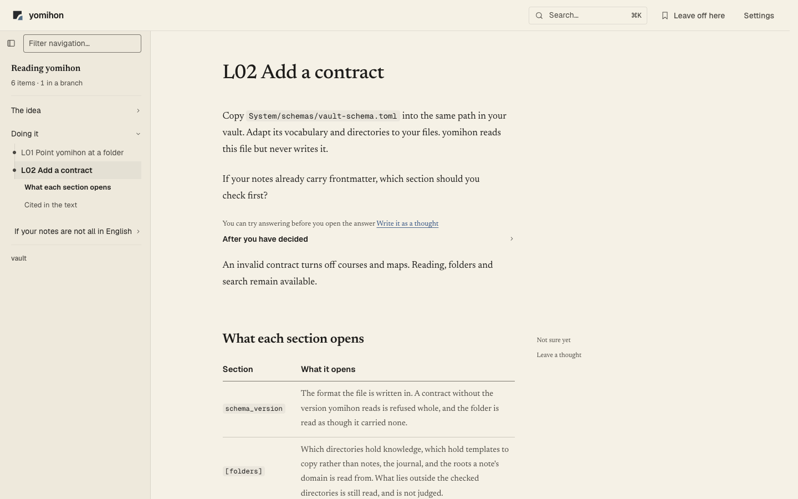

<h1><picture><source media="(prefers-color-scheme: dark)" srcset="assets/brand/yomihon-mark-on-paper.svg"></picture> yomihon</h1>

English | [繁體中文](README.zh-TW.md)

[](https://github.com/koopa0/yomihon/actions/workflows/ci.yml)
[](go.mod)
[](LICENSE)

**yomihon turns the Markdown you have already organised into a book that reads well.**

[](.github/media/reading-en.png)

A course lists its parts and marks the lesson you are on. Search, backlinks and reports are built in. yomihon runs on your machine and never edits your text: the one thing it writes into your vault is your own highlights, thoughts and questions, in a file of their own for each computer under `reader-notes/.yomihon/marks/`, which git carries to your other computers. yomihon itself makes no network request. A figure — an interactive HTML file a note embeds — runs no script unless you approve its exact bytes, and the browser fetches nothing it names on its own (a link in it that you click opens a connection before the page refuses the request); a figure you approved runs its scripts in your browser and can send data anywhere.

## Try it

[yomihon.koopa0.dev](https://yomihon.koopa0.dev) runs the [example vault](examples/README.md) from this repository. Visitors share one copy of the notes. It is restored every hour.

## Install

[Download a binary](https://github.com/koopa0/yomihon/releases/latest) from the latest release, or install with Go 1.27 or newer:

```sh
go install github.com/koopa0/yomihon/cmd/yomihon@latest
```

`@latest` installs the latest release; `@main` installs the development head.

yomihon runs on macOS, Linux and Windows. The example vault comes with the source, not the binary. Take it from the release's source archive or clone this repository.

## Use

```sh
yomihon ~/notes
```

Then open <http://127.0.0.1:9610>. yomihon reads any folder of Markdown as it is, with courses, units and indexes read from the type a note names. A rules file, `System/schemas/vault-schema.toml`, adds validation to `yomihon check` and decides what `check`, `coverage`, `exists` and `marks` withhold. `yomihon examples/vault` opens a vault that has one to copy. If an agent writes your notes, point it at [`skills/`](skills/) first.

To turn your notes into a course, follow [Make a course](docs/authoring.md). It covers the starter rules file, lesson files, the main line and an optional side branch.

## What it does

- **Read.** Wikilinks, callouts, footnotes, tables, Mermaid diagrams, code and ruby render as written. Settings offer light, dark or the system's appearance, three text sizes, and serif, sans serif or Kaiti type. "Leave off here" keeps your place on this device. The reading desk, the home page, links back to it.
- **Learn.** A course lists its parts, marks the lesson you are on and links the lessons before and after it. A side branch is optional reading. Furigana can be hidden. A Japanese passage the author marks in a lesson can be read aloud. The example vault has [a Go concurrency course](examples/vault/Notes/Books/Go%20並行入門.md) and [two Japanese dialogue lessons](examples/vault/Notes/Books/在圖書館讀日文.md).
- **Find.** Search works in English, Chinese and Japanese. A note's sections stand in the sidebar, and the notes that cite it close the text. A map lists the notes under one subject.
- **Reports.** Markdown reports written directly in `System/reports/` are listed newest first by the day in their `created` field, or the date their file name begins with, each by its title. They are tied together by the links they carry.
- **Check.** The Health page lists wikilinks that point at nothing and notes no other note links to. `yomihon check` lists broken links and frontmatter problems in a terminal.
- **Pick up your marks.** `yomihon marks` lists your questions and your thoughts that still declare `draft: true`, newest first, so an agent can read them. Nothing under a directory your rules file withholds is listed.

The interface is available in English and Traditional Chinese. A note keeps the language it was written in.

## Status

Under development; expect the interface to change before the first stable release. Defects go to [Issues](https://github.com/koopa0/yomihon/issues), security problems to [GitHub's private advisory form](https://github.com/koopa0/yomihon/security/advisories/new).

## Licence

yomihon is released under the [MIT licence](LICENSE).
