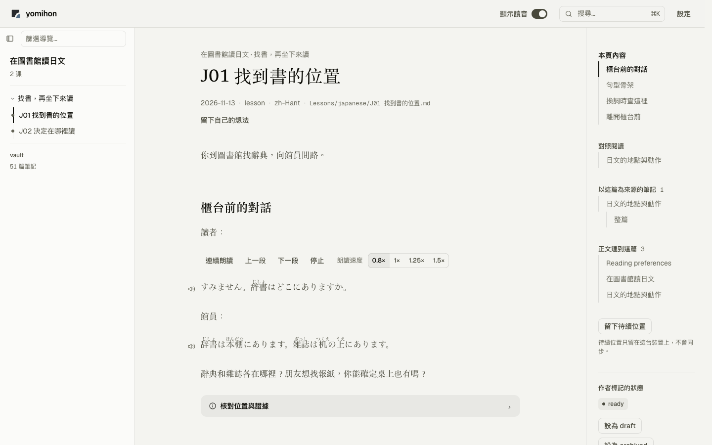

<h1><picture><source media="(prefers-color-scheme: dark)" srcset="assets/brand/yomihon-mark-on-paper.svg"></picture> yomihon</h1>

[English](README.md) | 繁體中文

[](https://github.com/koopa0/yomihon/actions/workflows/ci.yml)
[](go.mod)
[](LICENSE)

**yomihon 把你整理好的 Markdown，變成好讀的讀本。**

[](.github/media/reading-zh-TW.png)

一門課程分成幾部，也標出你讀到哪一課。搜尋、反向連結與報告都內建。yomihon 在你的機器上執行，不改你的文字。yomihon 本身不發出任何網路請求。圖解（筆記嵌入的互動 HTML 檔）在你核可它的確切內容之前不執行任何腳本，瀏覽器也不會自行載入它指名的任何東西（你點了其中的連結時，瀏覽器會先建立連線，頁面才擋下請求）；你核可過的圖解會在你的瀏覽器裡執行腳本，可以把資料送到任何地方。

## 線上試讀

[yomihon.koopa0.dev](https://yomihon.koopa0.dev) 上執行的是本 repo 的[範例書庫](examples/README.zh-TW.md)。所有訪客共用同一份筆記。每小時還原一次。

## 安裝

從最新版本[下載執行檔](https://github.com/koopa0/yomihon/releases/latest)，或用 Go 1.27 以上的版本安裝：

```sh
go install github.com/koopa0/yomihon/cmd/yomihon@latest
```

`@latest` 安裝最新的發行版，`@main` 安裝開發中的最新版本。

yomihon 可在 macOS、Linux 與 Windows 上執行。範例書庫附在原始碼裡，不在執行檔中。請從該版本的原始碼壓縮檔取得，或 clone 本 repo。

## 使用

```sh
yomihon ~/notes
```

接著開啟 <http://127.0.0.1:9610>。任何 Markdown 資料夾都能直接讀。課程、地圖與 `yomihon check` 需要契約 `System/schemas/vault-schema.toml`。`yomihon examples/vault` 開啟的書庫附有一份，可以照著改。如果由 agent 替你寫筆記，請先讓它讀 [`skills/`](skills/)。

想把筆記排成一門課，請看[做一門課](docs/authoring.zh-TW.md)，從取得入門契約、寫每一課，到排主線與選讀支線。

## 它做什麼

- **讀。** wikilink、callout、註腳、表格、Mermaid 圖、程式碼與 ruby，照作者寫的呈現。設定頁可選亮色、暗色或跟隨系統，三段字級，明體、黑體或楷體。「留下待續位置」把你讀到的地方記在這台裝置上。閱讀桌（首頁）會列出這個待續位置，點一下就能回去。
- **學。** 一門課會列出各部，標出你讀到的這一課，連到前後各一課。支線是選讀。振假名可以隱藏。課裡作者標了朗讀的日文段落，可以唸出來。範例書庫有一門[《Go 並行入門》](examples/vault/Notes/Books/Go%20並行入門.md)，另有[兩課日文短對話](examples/vault/Notes/Books/在圖書館讀日文.md)。
- **找。** 搜尋支援中文、日文與英文。每篇筆記旁邊放著本頁章節與引用它的筆記。地圖列出同一主題底下的筆記。
- **報告。** 直接放在 `System/reports/` 的 Markdown 報告依日期由新到舊列出，每份以標題顯示。
- **檢查。** 整體狀況頁列出指向不存在目標的 wikilink，以及沒有其他筆記連過來的筆記。`yomihon check` 在終端機列出失效連結與 frontmatter 問題。
- **接著處理還沒想通的。** `yomihon left-open` 列出你標成「還不確定」的位置，以及仍寫著 `draft: true` 的想法，新的在前，讓 agent 也讀得到。契約扣住的資料夾裡的東西一概不列。

介面有英文與繁體中文。筆記保留寫下時的語言。

## 目前狀態

開發中；第一個穩定版之前，介面還會變。缺陷請開 [Issues](https://github.com/koopa0/yomihon/issues)，安全性問題請走 [GitHub 私密漏洞回報](https://github.com/koopa0/yomihon/security/advisories/new)。

## 授權

yomihon 以 [MIT](LICENSE) 授權釋出。
