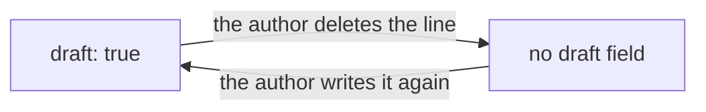

A note says it is still being written with one field, `draft: true`. yomihon defines the field itself, so [[The vault contract]] does not list it, and nothing else in a note records how far along it is.

## Leaving it out means finished

A note with no `draft` field is finished. Writing `draft: false` says the same thing, so a note never needs the field just to be complete. `yomihon check` reports a `draft` written as anything but `true` or `false`, because a value such as `yes` would otherwise read as a finished note.

## What the reader sees

A note that writes `draft: true` is marked as a draft, quietly, on its own page, in the sidebar and on its course. A reader's own thought that still carries it stays on the shelf of what was left open, and `yomihon left-open` lists it for a program.

## Nothing is written back

yomihon never writes into the vault. It sets no field, `draft` or any other, and offers no button that would: the flag changes only in the author's editor. A note that another note replaces is deleted in the editor too, and its name goes into the replacement's `aliases`, so links written to the deleted note's name still arrive.
