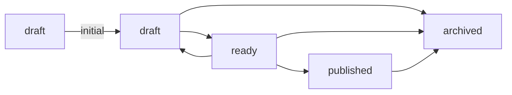

Each `[[lifecycle]]` row in [[The vault contract]] names one status: the note types it applies to, whether a note may start there, and which statuses it can be reached from. `yomihon check` holds every note to it; the reading pages print no status at all.

## initial is written out

Every row says whether a note can begin at that status. Writing `initial` on one row means writing it on all of them; a lifecycle that declares it on some rows and leaves the rest open is refused.

## published is declared and never set

The diagram shows transitions the contract allows, including `ready → published`. yomihon sets no status, `published` or any other: it never writes into the vault, and a status changes only in the author's editor.

## draft marks what is unfinished

A note that writes `draft: true` is marked as a draft on its own page, in the sidebar and on its course. A finished note carries no mark and needs no field: leaving `draft` out, or writing `draft: false`, is the same.
