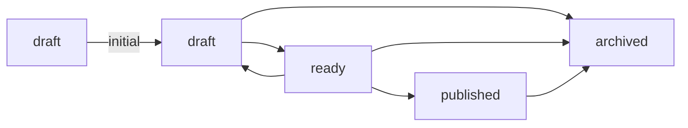

[[知識庫契約]]的每一列 `[[lifecycle]]` 說一個狀態：適用哪些類型、筆記能不能從這裡開始、能從哪些狀態走過來。`yomihon check` 會依它檢查每篇筆記；閱讀頁不印任何狀態。

## initial 要寫出來

每一列都要說筆記能不能從這個狀態開始。一列寫了 `initial`，其餘各列也得寫；寫一半的生命週期會被拒絕。

## published 宣告得出來，卻不會被設定

上圖呈現契約允許的轉換，包含 `ready → published`。yomihon 不設定任何狀態，`published` 或其他都一樣：它從不寫入書庫，狀態只在作者的編輯器裡改動。

## draft 標出還沒寫完的

寫了 `draft: true` 的筆記，會在自己的頁面、側欄與課程上標為草稿。寫完的筆記不加標記，也不需要這個欄位：不寫 `draft` 和寫 `draft: false` 是一樣的。
