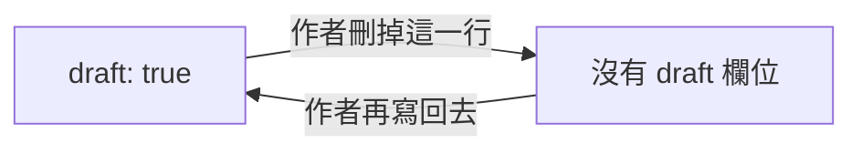

筆記用一個欄位說自己還沒寫完：`draft: true`。這個欄位由 yomihon 自己定義，所以[[知識庫契約]]不必列出它；筆記裡也沒有別的欄位記錄寫到哪裡。

## 不寫就是完成

沒有 `draft` 欄位的筆記就是寫完了。寫 `draft: false` 意思相同，所以筆記不需要為了「完成」而加這個欄位。`draft` 寫成 `true`、`false` 以外的值，`yomihon check` 會回報，因為像 `yes` 這樣的值否則會被當成已完成。

## 讀者看到什麼

寫了 `draft: true` 的筆記，會在自己的頁面、側欄與課程上安靜地標為草稿。讀者自己的想法若還帶著它，就留在「還沒想通的」書架上，`yomihon left-open` 也會把它列給程式。

## 不會寫回書庫

yomihon 從不寫入書庫。它不設定任何欄位，`draft` 也一樣，也沒有任何按鈕會這麼做：這個旗標只在作者的編輯器裡改動。被另一篇取代的筆記，也是在編輯器裡刪掉，原名放進接手那篇的 `aliases`，寫給原名的連結照樣到得了。
